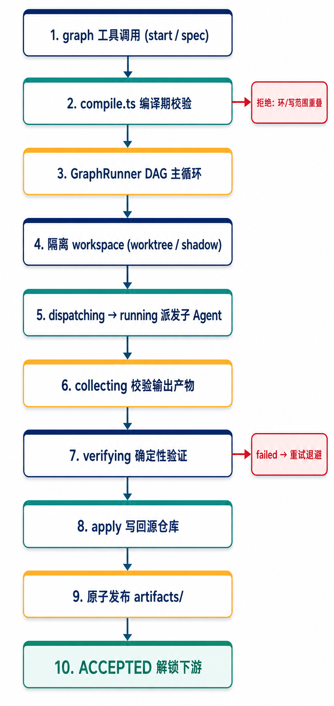
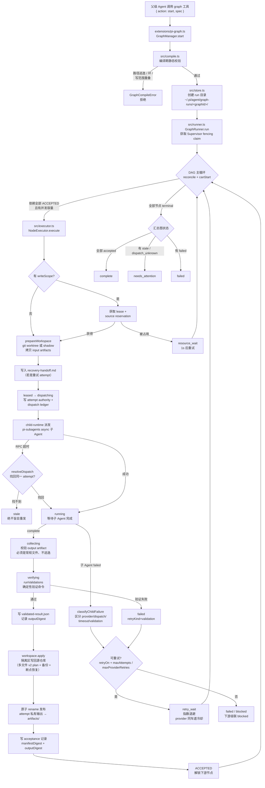
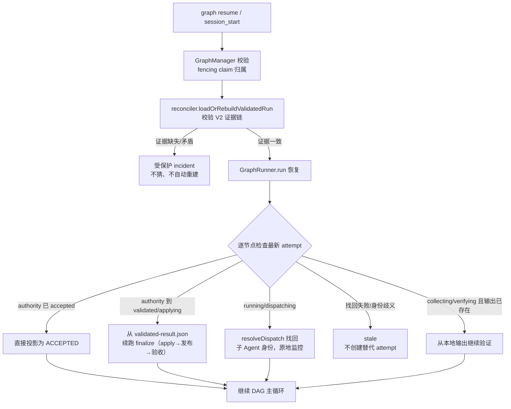
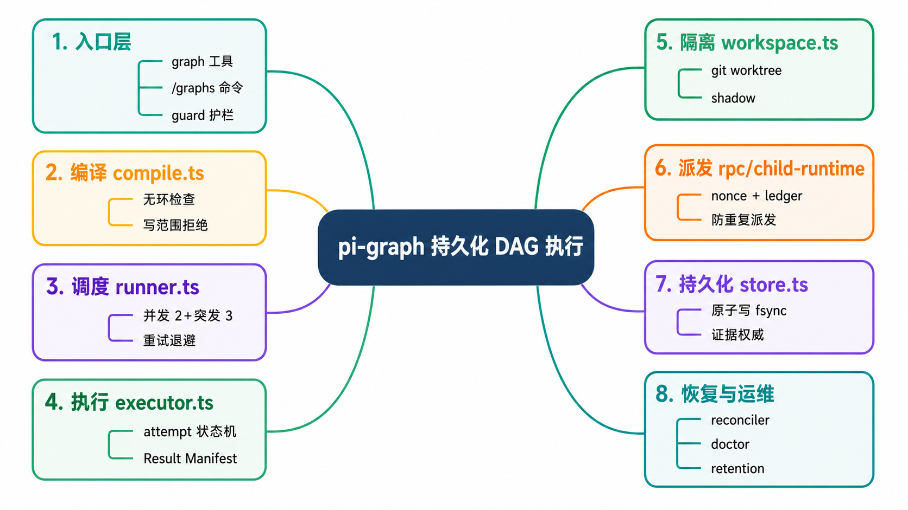
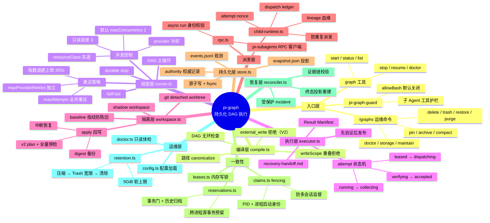

# pi-graph 架构详解

`pi-graph` 是 Pi 的持久化 DAG 执行引擎：把父级 Agent 提交的 GraphSpec 编译成一个有向无环图，为每个节点启动独立的 `pi-subagents` 异步子 Agent，持久化每一次状态迁移，隔离写入，做确定性验证，只有 Supervisor 判定 `ACCEPTED` 的节点才能解锁下游。

它**故意不做**：是否该用 Graph 的判断、目标拆解、模型选择、上下文搜索。这些是 `agent-workflow` 和父级 Agent 的职责。

---

## 一、分层结构

| 层 | 文件 | 职责 |
|---|---|---|
| 入口 | `extensions/pi-graph.ts` | 注册 `graph` 工具（start/status/list/stop/resume/doctor）与 `/graphs` 运维命令；向 pi-subagents 注册 background-work provider，防止 headless 会话在节点间退出 |
| 护栏 | `extensions/pi-graph-guard.ts` | 注入子 Agent workspace 的策略护栏；默认 `allowBash:false`，路径类工具限制在声明 scope 内，畸形合同 fail closed |
| 管理 | `src/manager.ts` (`GraphManager`) | 图级生命周期：start/stop/resume/list、session_start 认领本会话的活跃图、session_shutdown 挂起监督、维护任务 |
| 编译 | `src/compile.ts` | GraphSpec → CompiledGraph：路径 canonicalize（realpath、禁止逃逸 cwd）、DAG 无环检查、**编译期拒绝 writeScope 重叠的并行节点** |
| 调度 | `src/runner.ts` (`GraphRunner`) | DAG 主循环：并发控制（默认 2，只读突发 3）、`resourceClass` 车道限流、provider 冷却、重试调度（业务 `maxAttempts` 与 `maxProviderRetries` 分离） |
| 执行 | `src/executor.ts` (`NodeExecutor`) | 单节点单 attempt 的完整状态机（见下） |
| 隔离 | `src/workspace.ts` | git 仓库用 detached worktree，其他用 shadow workspace；写入先落在隔离区，验证通过后才回放源仓库 |
| 验证 | `src/validation.ts` | `validationCommands`：argv 无 shell 执行、可执行文件白名单、禁止内联解释器载荷与路径逃逸 |
| 派发 | `src/rpc.ts` + `src/child-runtime.ts` | 通过 pi-subagents RPC 派发 async 子 Agent；dispatch ledger + lineage + nonce 保证"派发结果未知时查找/保护，绝不盲目重发" |
| 持久化 | `src/store.ts` (`GraphStore`) | 原子写 + fsync（文件与父目录）；`snapshot.json` 投影、`events.jsonl` 观测、attempt/acceptance 权威记录 |
| 一致性 | `src/claims.ts` / `leases.ts` / `reservations.ts` | fencing claim（PID+进程启动身份）防两个会话同时监督同一张图；写 scope 有内存 lease + 跨进程 source reservation 两级保护 |
| 恢复 | `src/reconciler.ts` | 崩溃后从证据链重建可信投影；证据缺失/矛盾时创建受保护 incident 而不是猜 |
| 运维 | `src/doctor.ts` / `src/retention.ts` | 只读体检；历史压缩、Trash 宽限期删除、存储报告 |

---

## 二、流程图：从 graph 工具调用到 ACCEPTED

---

## 三、流程图：崩溃恢复（resume / session_start 认领）

---

## 四、脑图：模块全景

---

## 五、关键设计决策

1. **Graph 只执行给定的 DAG**。路由、拆解、模型选择留在 `agent-workflow` / 父级 Agent；Graph 不自行扩张目标，也不替代 pi-convergence。
2. **ACCEPTED 是唯一的解锁信号**。一个节点必须同时满足：子 Agent 完成 + 确定性验证通过 + workspace 变更回放完成 + Result Manifest 生成。下游通过 `inputArtifacts` 消费已发布产物，不能在任务正文里隐式依赖未验收结果。
3. **先隔离、先验证、后发布**。子 Agent 的写入发生在 worktree/shadow 隔离区；输出先落 attempt 私有路径，验证通过后才原子 `rename` 到 `artifacts/`。失败的 workspace 变更永不自动应用。
4. **派发宁可 stale 不可重复**。一旦派发可能已经逃逸（RPC 超时、进程崩溃），同一 attempt 只能被查找或保护，绝不盲目重发——配合 nonce、dispatch ledger、lineage 实现。
5. **权威在证据，不在投影**。Runtime V2 中 `authorization.json`、attempt 记录、validated result、acceptance 记录是权威；`snapshot.json` 是可重建投影，`events.jsonl` 只是观测。恢复时证据缺失或矛盾就创建受保护 incident，绝不猜测。
6. **监控无隐式 deadline**。子 Agent 只有在节点显式声明 `timeoutMs` 时才因耗时被杀；资源等待可观测但不杀活跃子 Agent。
7. **provider 故障与业务故障分离**。`maxProviderRetries` 独立计数、独立指数退避，同 `resourceClass` 车道的其他节点会被冷却暂停，但不挤占业务 `maxAttempts`。

## 六、验证方式

- `npm test`：确定性回归套件（编译、快照、租约、保留策略、RPC 生命周期、失败分类等）。
- `npm run test:soak`：60 秒长任务场景 + 挂起/恢复 + 写冲突压测；用确定性模拟子 Agent，不消耗模型配额。
- `PI_GRAPH_SOAK_MS=300000 npm run test:soak`：延长到约 5 分钟（合法区间 15 秒 ~ 30 分钟）。
