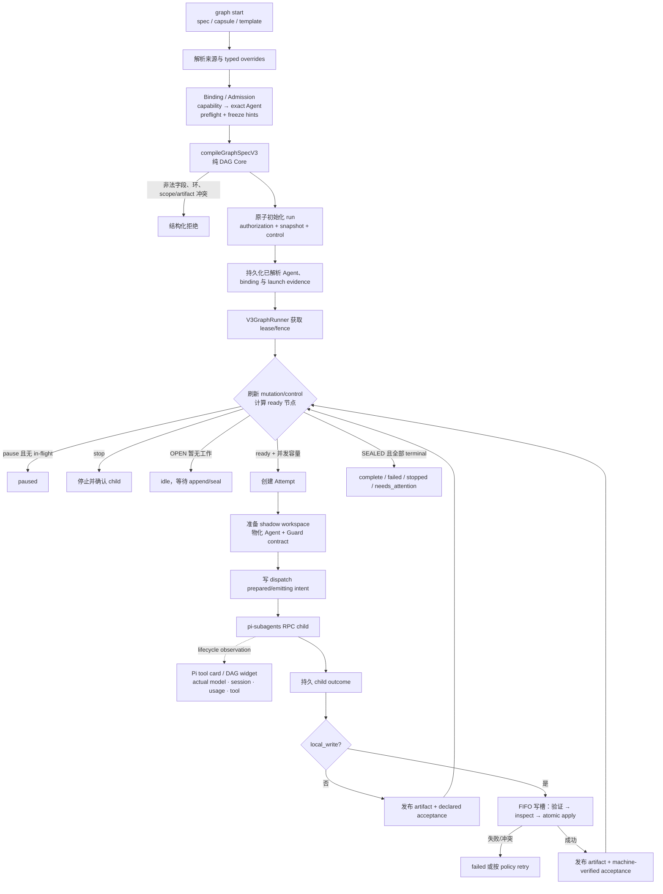
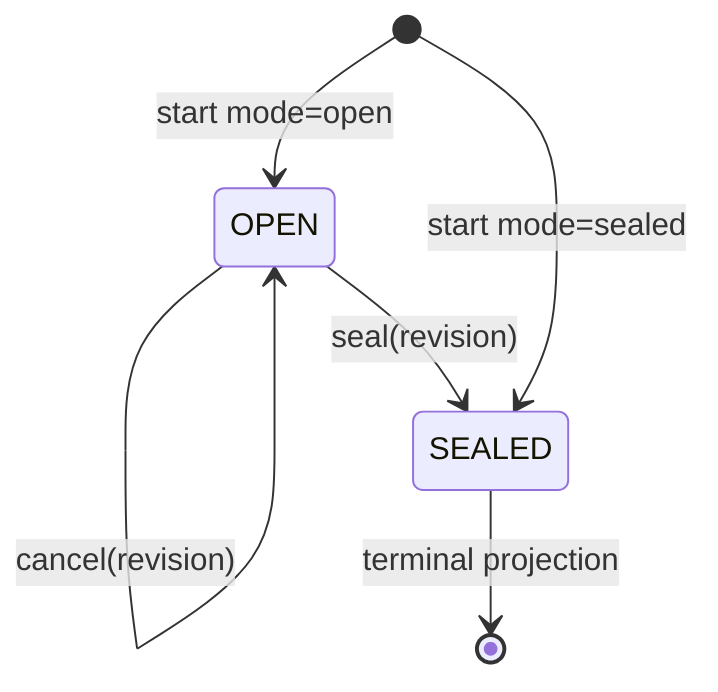
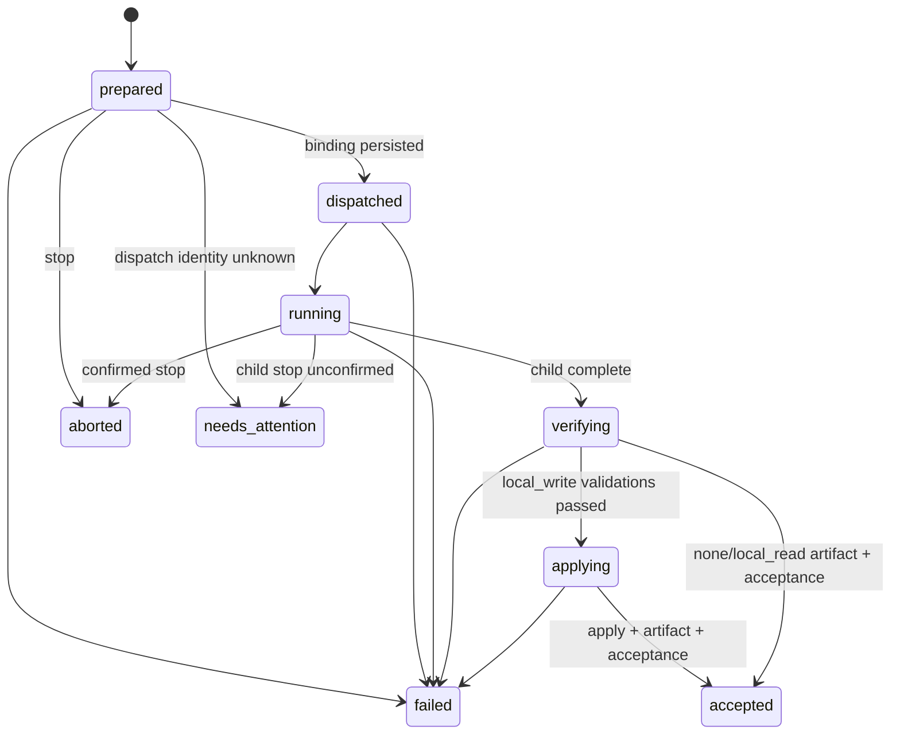
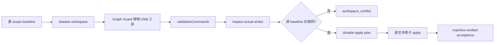

# pi-graph V3 架构

pi-graph 当前只有一个核心职责：可靠执行调用方已经定义好的 DAG。Pi 适配器在进入 Core 前完成 capability binding，在 Core 外投影实时观测；生产链路不存在旧 GraphManager、治理门或模型路由旁路。

```text
GraphSpec authoring / capsule / template
            │ capabilityId / requires / launch hints
            ▼
 Pi Binding / Admission adapter
            │ exact Agent + immutable binding/admitted launch hints
            ▼
 Pure DAG Core
 compileGraphSpecV3 → V3GraphHost → V3GraphRunner
            │
            ├── pi-subagents RPC child
            ├── shadow workspace + Graph Guard
            ├── deterministic validation + atomic apply
            └── Attempt / acceptance / artifact evidence
            │ bounded runtime observation
            ▼
 Pi Observability / TUI
 actual Agent/model · child session · usage · tool progress · DAG panel
```

Binding 只做一次确定性归约：能力目录里的多个 capability 必须全部映射到同一个 Agent；`pi-subagents` 公共 preflight 解析 source Agent 与当时可知的 launch hints；resolved primary 或任一 fallback candidate 如果使用当前由 Pi Extension 注册/覆盖的 Provider，就在 admission fail closed。然后目录选择证据、Agent 定义和 admission preflight digest 被持久化。Core 的输入从此只有 exact Agent 和不可变证据，恢复也不会再次读取 ambient catalog。真正 child 合同还会加入 Guard、dependency capsule 和 workspace 信息，其 runtime `launchContractDigest` 是独立的 lifecycle 证据。

## 1. 分层

| 层 | 主要文件 | 责任 |
| --- | --- | --- |
| Pi 入口 | `extensions/pi-graph.ts` | 注册 15 个 `graph` actions（含只观察不控制的 `wait`）、`/graphs`、background-work provider 和 session 生命周期 |
| Binding / Admission | `src/v3/binding.ts`, `preflight.ts` | capability catalog → exact Agent；规范化 model/thinking/budgets；持久化 binding、Agent definition 与 admission preflight evidence |
| Child 护栏 | `extensions/pi-graph-guard.ts` | 执行 node contract：scope、readOnly、toolFilter、保护路径、bash 禁用 |
| 输入 | `src/v3/graph-capsule.ts`, `templates.ts` | 安全读取 `.graph.json`、类型化输入替换、内置 capability 模板、进入 Binding |
| 编译 | `src/v3/compiler.ts` | 严格 schema、拓扑排序、环/依赖/artifact/scope 检查、digest |
| Admission | `src/v3/initialize.ts`, `authorization.ts`, `source-identity.ts` | 原子创建 run、绑定源目录身份、写 Authorization V4 和初始 Snapshot V3 |
| Host | `src/v3/host.ts`, `config.ts` | start/load/status/list/control、恢复认领、动态变更、显式 retry |
| Control | `src/v3/control.ts` | `running/paused/stopped` desired state 与 revision CAS |
| 动态拓扑 | `src/v3/mutations.ts` | OPEN/SEALED、append/cancel/seal、revision CAS、digest-chain journal |
| 调度 | `src/v3/runner.ts`, `scheduler.ts` | dependency readiness、when、并发、failFast、Attempt 状态机、恢复 |
| 派发 | `src/v3/dispatch.ts`, `rpc.ts` | stable request ID、durable emit intent、exact binding、child 监控/停止 |
| Workspace | `src/v3/workspace.ts` | shadow workspace、Agent freeze、baseline、write inspection、atomic apply |
| 验证 | `src/v3/validation-command.ts`, `verify.ts` | argv 白名单、shell:false、deadline、字节上限、进程树终止 |
| 证据 | `src/v3/attempt.ts`, `events.ts`, `projection.ts`, `snapshot.ts` | Attempt/validation/acceptance、最佳努力事件、可重建 snapshot |
| Observability | `src/v3/observability.ts`, `projection.ts`, `extensions/pi-graph.ts` | 有界清洗 child lifecycle；requested/resolved/actual、session、usage、tool progress；Pi 工具卡/widget/status |
| 排他写者 | `src/v3/lease.ts`, `claims.ts` | PID+process identity lease、单调 Supervisor generation fence |
| 重试 | `src/v3/retry.ts` | 目标+下游 retry intent、Attempt baselines、崩溃后一次性继续 |
| 数据交接 | `src/v3/capsule.ts` | 有界、不可信的直接依赖 output capsule |
| 原子原语 | `src/v3/durable.ts`, `digests.ts`, `path-safety.ts` | fsync/rename/link、canonical digest、可信目录锚 |

## 2. 从 `graph start` 到完成



关键边界：

1. `start` 在初始化完成后异步返回，不等待全图完成。
2. child 自报 complete 不是 ACCEPTED；写节点还必须验证并 apply。
3. acceptance 最后发布，所以不会指向半写产物。
4. 一个节点 accepted 后立即解锁自己的下游，不等待无关同层节点。
5. 单图所有 `local_write` 节点按获得写槽的 FIFO 顺序串行整个 Attempt，读节点仍可并发。
6. requested/resolved 字段来自 admission，actual 字段只能来自 child lifecycle；观测变化不会改变 acceptance digest。

## 3. 编译后的图

编译器把输入转成 `CompiledGraphV3`：

```text
sourceGraphSpec + sourceGraphSpecDigest
compiled nodes + topologicalOrder
graphDigest
maxConcurrency + failFast + workspace=shadow
mode(open 仅显式保留；sealed 为默认省略表示)
resolved Agent + binding evidence + Pi launch hints（节点可选）
```

编译器是所有入口的共同信任边界：内联 spec、capsule、模板、append 后候选图、恢复时 Authorization 都会再次经过它。这样动态拓扑和恢复不能绕过首次 admission 规则。

公开 authoring spec 先经过 Binding。`contractPolicy: strict`、`capabilityId`、`requires`、`model`、`thinking`、`turnBudget`、`toolBudget`、`usageBudget` 和 `maxTokens` 都是 adapter 输入；它们不会原样进入 Core。Binding 产生 `bindingPolicy: strict`、节点 `agent`、`binding` 和 `launch`。`maxTokens` 与累计 `usageBudget` 分开持久化，并在 child provider 请求边界由 Graph Guard 执行；Core 只校验这些持久化字节，不做 Agent/model selection。

能力目录中的 `routingProfile` 和非 fixed `modelPolicy` 不会在 Graph 中求值。只有 fixed `modelPolicy.model` 可成为宿主 launch hint；最终可用模型和 thinking 仍由 `pi-subagents` preflight 决定。未被 Extension 注册/覆盖的普通 `models.json` Provider 可以使用。父 Pi 已知的扩展 Provider 在 Binding 拒绝；Agent 只在 Child 内注册或覆盖当前 Provider 时，Graph Guard 在 Pi 0.81 的 `input` 边界返回 `handled`，确保自定义 `streamSimple` 启动前停止。`before_provider_request` 只负责标准 Provider payload 的 `maxTokens`，不能承担扩展 Provider 隔离。

scope 冲突检查同时考虑 read/write：无祖先关系的两个节点如果可能触碰同一路径，会在执行前被拒绝。有显式依赖顺序时允许重叠，因为上游必须 accepted 后下游才可运行。

## 4. 调度模型

### 普通依赖

普通节点的全部 `dependsOn` 必须 accepted。failed、aborted、needs_attention 或 cancelled 依赖会让下游 blocked；skipped 依赖使下游 skipped。

### 条件依赖

`when` 只允许观察一个直接依赖的 accepted 或 failed。匹配的 failed 边可以解锁条件节点，但不会修改原失败 Attempt，因此最终图仍能反映失败。

### synthetic state

`skipped`、`blocked`、`cancelled` 不对应 child 执行。`scheduler.ts` 从拓扑、cancel journal 与真实 Attempt 终态计算 fixed point；`projection.ts` 把结果写进 snapshot。恢复时可以重新推导，而不需要伪造 Attempt 文件。

### 并发与写槽

- 图并发默认 2，最大 6。
- read/none 节点只受图并发上限控制。
- `local_write` 节点从 Attempt 开始到终态持有单图 FIFO 写槽，避免多个写 child 的工作期交叠。
- 动态 mutation 正在 fence 内提交时，runner 暂停启动新节点，避免新拓扑与旧 ready 观察交错。
- `failFast` 为 true 时，任何 failed/needs_attention 终态会阻止继续启动未开始节点；in-flight 节点先正常收尾。

## 5. OPEN/SEALED 与 mutation



拓扑状态与执行状态正交：OPEN 可以 running 或 idle；SEALED 可以 queued/running/terminal。每次 append/cancel/seal 都在 live Supervisor fence 中重新读取当前 journal、比较 revision、验证候选结果，再 no-replace 发布下一条完整记录。

cancel 和 Attempt 创建争用同一 fence：cancel 先赢时节点保持 Attempt-free cancelled；Attempt `prepared` 先赢时 cancel fail closed。这个顺序点避免“已经启动但又被投影成从未执行”的矛盾。

## 6. Attempt 状态机



每次 phase 更新都落在独立 `attempt.json` 中，并带 run/graph/task/attempt/nonce/epoch 身份。自动 retry 创建下一个数字 Attempt；历史 Attempt 不覆盖。显式 retry 也从最新 baseline 增一，每节点总上限 100。

`timeoutMs` 被转换成 Attempt 创建时的绝对 `deadlineAt`。所有异步阶段每次开始都计算剩余时间；恢复仍读取同一个 deadline。

## 7. 派发崩溃窗口

RPC 调用不是原子文件操作，因此 runner 在 emit 前建立 durable intent：

```text
prepared intent
    ↓
emitting intent（RPC 边界可能已经跨过）
    ↓
dispatch binding（asyncId + asyncDir + requestDigest）
```

stable request ID 来自 Attempt nonce，用来关联同一次 RPC 的 reply。`prepared` intent 可在校验 request digest 后安全发出一次；`emitting` 表示 child 可能已经创建。由于 `pi-subagents 0.56` 的 single-run status 不持久化外层 request ID，若此时尚未持久化 exact `{ asyncId, asyncDir }` binding，新 Supervisor 无法可靠找回原 child，只能进入 `needs_attention`，不会重发一个“看起来相同”的 child。

stop/timeout 也遵循同一原则：发送 child stop 后必须得到确认。确认窗口耗尽意味着 child 可能仍存活，因此不能安全重试或宣布 stopped。

## 8. 写入安全链



Graph Guard 与 shadow workspace 分工不同：

- shadow 降低错误 child 直接破坏源文件的风险；
- Guard 在 Pi tool-call 边界限制读写 scope、工具名和保护目录；
- baseline 检查发现 source 在 child 工作期间被其他进程改变；
- deterministic validation 验证结果，而不是验证 child 的自我陈述；
- apply plan 处理进程在多文件提交中途崩溃的恢复。

它们仍不是 OS sandbox；直接以同一用户操作文件系统的恶意代码不在保证范围内。

## 9. 证据与投影

```text
不可变/append-only authority
  authorization.json
  mutation-journal/*
  retry-journal/*
  nodes/*/attempts/*/{attempt,workspace,validated-result,acceptance}.json
  artifacts/*/attempt-N.txt

持久控制 authority
  control.json
  supervisor-fence.json
  lease.json（只在持有期间存在）

可重建/观测
  snapshot.json
  artifacts/<taskId>.txt（latest alias）
  events.jsonl（unverified，best effort）
```

Attempt 的 `observation` 与 snapshot 节点 observation 是有界、去 ANSI/控制字符的投影，最多包含 requested/resolved/actual Agent 与模型、attempted models、child run/session、launch contract digest、token/cost/turn usage、duration、current tool/path 和活动计数。原始 lifecycle payload 不被持久化。除已上报 token/cost 用于后续 Attempt 的 usage-budget fail-closed 核算外，这些字段不参与调度、child 恢复与 acceptance digest。

恢复顺序是“重新编译 admission → 重放 mutation → 读取 retry baseline → 校验 lease/source/Agent/workspace/Attempt → 重建 snapshot”。不能从 `events.jsonl` 推导 authority，也不能因为 snapshot 写着 running 就盲目信任旧进程仍拥有执行权。

## 10. Supervisor fencing

lease 用 PID 加进程启动身份防 PID 重用；generation ledger 在每次 acquire/takeover 时单调递增。旧 generation 的 capability 即使还留在内存里，也无法通过 `assertCurrent`/`withFence`。

fence 覆盖 Attempt 写入、snapshot、apply、acceptance、mutation 和 retry。它既是“单 Supervisor”约束，也是动态 cancel 与 Attempt create 的线性化点。

## 11. pause、resume、stop、retry

控制意图和观察状态分开：

- `pause` 先写 control，再禁止新 dispatch；现有 child 收尾后 paused。
- `resume` 把 desired state 改为 running，现场校验证据并继续。
- `stop` 写 stopped intent，要求活跃 child 确认停止，未开始节点转 aborted。
- session shutdown 等价于对本 session 的活跃图 durable pause。
- `retry` 只在整图 terminal 时提交，目标节点及其未取消下游按 durable baseline 重跑。

重启 adoption scan 尊重 `control.json`：paused 不擅自继续，stopped 不擅自变 running，pending retry 在拿到新 lease 后继续。

## 12. 与 dsh-graph 的架构映射

pi-graph 保留了 dsh-graph 的关键形状：

```text
compiler              → compiler.ts
event-driven DAG loop → runner.ts + scheduler.ts
OPEN mutation         → mutations.ts
Attempt history       → attempt.ts
dependency hand-off   → capsule.ts
capsule/templates     → graph-capsule.ts + templates.ts
versioned artifacts   → runner.ts artifact publication
localWriteLock        → runner.ts FIFO local-write slot
```

宿主适配和耐久性实现不同：dsh-graph 聚合 `run.json` 并假设单 Host writer；pi-graph 使用 Pi Binding、`pi-subagents` RPC、多文件证据、shadow apply、durable control、原生 TUI 观测以及跨进程 lease generation fence。这里的目标是复用已验证的架构语义，不是逐文件移植源码。

## 13. 明确删除的架构

主链中不存在以下层或模块角色：

```text
assess_task
plan_graph
review_graph_spec
planning receipt
routing policy / model registry
model resolver / degradation
visual evidence gate
legacy GraphManager / legacy executor
```

这里删除的是 Core 内启发式路由、模型注册表和降级策略，不是 Pi Binding 的确定性 capability lookup 或显式 launch hints。任何未来需要任务评估、规划或策略路由的功能，应位于调用方或独立扩展，不得悄悄塞回 DAG 执行内核。


运行时适配：Graph 兼容未修改的 pi-subagents 0.67.x，通过公开 RPC、完成通知、结果回放与进程退出证明接入；在 Graph Attempt 目录保存完整结果和退出证明，二者齐全后才进入验收。Graph 不覆盖上游执行时限，原版单子任务默认 30 分钟。公开证据不足时保留待核对状态，不自动重跑，不安装补丁。详见 README「原版 pi-subagents 适配与结果恢复」。
